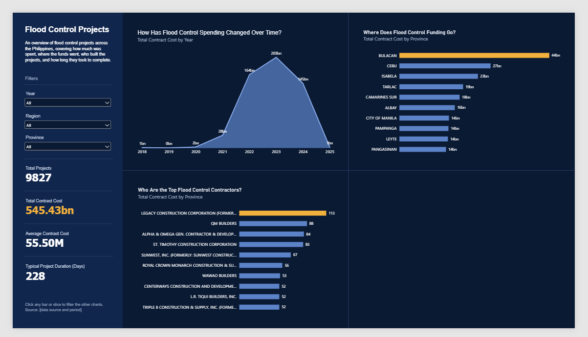

# Philippines Flood Control Projects

An interactive Power BI dashboard examining flood control projects across the Philippines from 2018 to 2025. It answers four questions: when the money was spent, where it went, who built the projects, and how well they were completed.



---

## Overview

The dashboard is a single page with four charts, four headline cards, and four filters.

|                    |                                                                                  |
| ------------------ | -------------------------------------------------------------------------------- |
| **Data source**    | [BetterGov Open Data Portal](https://data.bettergov.ph/datasets/2)               |
| **Coverage**       | 2018–2025 (infrastructure year)                                                  |
| **Records**        | 9,827 projects across 98 provinces and 16 regions                                |
| **Contractors**    | 2,409 contractor names (includes joint ventures)                                 |
| **Work types**     | 18 types of flood control work                                                   |
| **Tools**          | Power BI Desktop, DAX                                                            |

---

## Key Findings

**When was the money spent?**

- Total contract cost is **₱545.43 billion** across **9,827** projects.
- **94%** of the spending happened in **2022 to 2024**, peaking at **₱203 billion in 2023**.
- 2018 to 2020 combined account for only about ₱3.4 billion, so the early years are thin in this data.

**Where did it go?**

- **Bulacan** received the most, about **₱43.8 billion (8% of the total)**, and was the top province in 2022, 2023, and 2024.
- Cebu (₱26.6B), Isabela (₱22.9B), Tarlac (₱18.6B), and Camarines Sur (₱17.6B) complete the top five.
- The top five provinces together hold about **24%** of total spending, and Region III accounts for about **18%**.
- **Construction of Flood Mitigation Structure** makes up about two-thirds of all spending.

**Who built the projects?**

- Spending is **not concentrated** in a few contractors. The top 10 contractors hold about **10%** of the total.
- **Legacy Construction Corporation** has the most projects, and **Alpha & Omega Gen. Contractor & Development Corp.** works in the most provinces (31).

**How well did the projects go?**

- **91%** of projects finished on time or early: **65.0% on time** (6,388), **25.8% early** (2,530).
- **9.2% finished late** (905). Those ran a median of about **109 days (3.5 months)** behind the original target date.
- The typical project took **228 days**, and the average contract cost about **₱55.5 million**.

---

## Dashboard

| Section                    | Description                                                                              |
| -------------------------- | ---------------------------------------------------------------------------------------- |
| **Spending over time**     | Total contract cost by year. Selecting a year shows spending from 2018 up to that year.  |
| **Where the funding goes** | Top five provinces by total contract cost, with the highest highlighted.                 |
| **Top contractors**        | Top five contractors by number of projects, with the highest highlighted.                |
| **On-time completion**     | Share of projects finished early, on time, or late compared with the original target.    |
| **Headline cards**         | Total projects, total contract cost, average contract cost, and typical project duration.|

**Filters:** Year, Region, Province, and Type of Work. Every chart and card updates, and clicking any bar or slice filters the other charts.

---

## Design and Modeling Decisions

- **Cumulative year view:** a separate `Year Axis` table and a `Spend Up To Selected Year` measure let the area chart show every year up to the selected one, instead of only that year.
- **Dynamic highlighting:** the `Top Province Color` and `Top Contractor Color` measures color the top bar based on the current filters, so the highlight always follows the data.
- **On-time definition:** the `Completion Status` calculated column compares actual completion with the original target date. A **30-day margin** is used, because without it about 56% of projects would count as late, mostly by a single day.
- **Missing target dates:** four projects have no original target date. They cannot be classified and are left out of the on-time chart.
- **Approved budget not used:** the approved budget repeats on every row of a contract that is split into several components, which would overcount it by about ₱11 billion. It was excluded rather than reported inflated.
- **Typical duration:** this card uses the median, so a few very long projects do not skew it.

---

## Limitations

- **2018 to 2020 contain little data** and **2025 is a partial year**, so low spending in those years does not mean low activity.
- **On-time results should not be compared across years.** Later years look more "early" because only completed projects appear in the data.
- **Contract cost is the awarded amount**, not the final amount paid.

---

## Repository Structure

```
flood-control-projects/
│
├── data/
│   └── flood_control_clean.xlsx
│
├── dashboard/
│   ├── screenshots/
│   │   └── 01-dashboard.png
│   │
│   └── Flood Control Projects.pbix
│
└── README.md
```

Open the `.pbix` file in Power BI Desktop to explore the dashboard.

---

## Credits

Data from the [BetterGov Open Data Portal](https://data.bettergov.ph/datasets/2).
